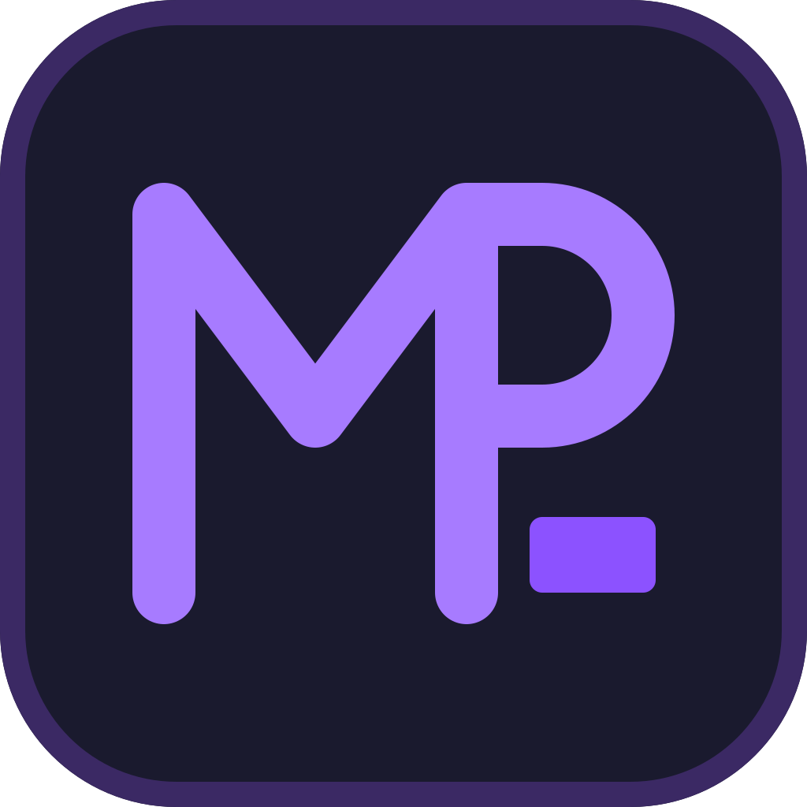

# Maciej Pałubicki

**.NET Software Engineer** · Koszalin, Poland · currently at i4B

I design and build backend systems in C# and .NET: ASP.NET Core APIs, gRPC and
message-driven microservices, SQL Server and PostgreSQL databases, and the migration of
legacy systems to modern .NET. Three years of commercial .NET experience; currently
learning Blazor.

- **Core:** C#, .NET, ASP.NET Core, gRPC, SignalR, Entity Framework Core, Dapper, MassTransit
- **Data:** SQL Server, PostgreSQL, Redis
- **Architecture:** Clean Architecture, DDD, CQRS, microservices
- **Testing:** xUnit, NUnit, integration tests with Testcontainers
- **Cloud and tools:** AWS, Azure, Docker, Terraform, CI/CD, NixOS
- **Also:** Python, TypeScript

I speak English and German and I'm learning Dutch.

## Projects

- [**Vertical Tabs**](https://github.com/MacPlb/Vertical-Tabs): open-files navigator for JetBrains IDEs that groups files by IDE module or .NET project
- [**macplb.github.io**](https://github.com/MacPlb/macplb.github.io): my website, generated by a .NET 10 app that renders Razor components to static HTML
- [**nix-os-configuration**](https://github.com/MacPlb/nix-os-configuration): my NixOS flake with niri, Home Manager and one color palette shared by every app
- [**ArduinoThermometer**](https://github.com/MacPlb/ArduinoThermometer): .NET MAUI app that reads and displays an Arduino thermometer
- [**BookStoreApi**](https://github.com/MacPlb/BookStoreApi): ASP.NET Core Web API with PostgreSQL running in Docker

## Contact

- Website: [macplb.github.io](https://macplb.github.io)
- LinkedIn: [Maciej Pałubicki](https://pl.linkedin.com/in/maciej-pa%C5%82ubicki-b83456253)
- Email: [macplb@proton.me](mailto:macplb@proton.me)

Outside of work I collect vinyl records and mechanical watches, play retro games and make pixel art.
