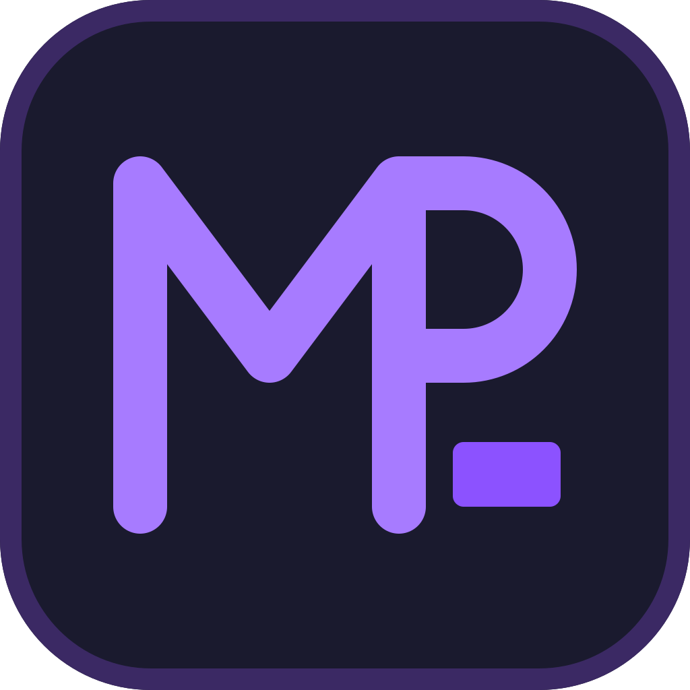

  

<h1 align="center">Maciej Pałubicki</h1>

  

  
  
  

  
  
  

> [!NOTE]
> Not looking for a new job right now, but always open to a chat.

## About me

I build ASP.NET Core APIs and gRPC microservices on the newest .NET, plus APIs in Python
and Go. I started with .NET as a trainee at GlobalLogic in 2022 and joined i4B as an intern
in 2023, where I now work as a software developer. Most of my work is backend architecture
in C#: I have written it since .NET 6. I am currently learning Blazor to build front ends
without leaving the .NET stack.

I speak English and German and I'm learning Dutch.

<strong>Experience</strong>

 

| Role | Company | When |
| --- | --- | --- |
| Software Developer | i4B, Koszalin · hybrid | Oct 2023 – present |
| Intern | i4B, Koszalin · on-site | Jul 2023 – Oct 2023 |
| Trainee .NET Developer | GlobalLogic, Koszalin · internship | Jul 2022 – Sep 2022 |

## Stack

  

<strong>The whole list</strong>

 

- **Languages:** C# (.NET 6+), Python (Django, FastAPI), Go (Gin, Bubble Tea), TypeScript
- **ASP.NET Core:** Web API, minimal APIs, SignalR, Identity, JWT, OAuth 2.0 / OpenID Connect, Blazor (learning)
- **Services:** gRPC, MassTransit, message queues, event-driven microservices
- **Data:** SQL Server, PostgreSQL, Redis, Entity Framework Core, Dapper
- **Architecture:** Clean Architecture, DDD, CQRS / MediatR, SOLID
- **Tests and telemetry:** xUnit, NUnit, Testcontainers, BenchmarkDotNet, Serilog, OpenTelemetry
- **Cloud and tools:** AWS (EC2, S3, Lambda, RDS, DynamoDB, Glue), Azure, Docker, Terraform, CI/CD, NixOS

## Projects

| Project | What it is | |
| --- | --- | --- |
| [**Vertical-Tabs**](https://github.com/MacPlb/Vertical-Tabs) | Open-files navigator for JetBrains IDEs; it docks on the left, groups files by IDE module or .NET project and can replace the editor tab bar |  |
| [**nix-os-configuration**](https://github.com/MacPlb/nix-os-configuration) | My NixOS systems and dotfiles; one flake builds the desktop and the laptop, themed with the palette my website uses |  |
| [**BookStoreApi**](https://github.com/MacPlb/BookStoreApi) | .NET Web API for managing a book store's authors, backed by PostgreSQL and run in Docker |  |
| [**ArduinoThermometer**](https://github.com/MacPlb/ArduinoThermometer) | .NET MAUI app that connects to an Arduino thermometer and shows its readings |  |
| [**macplb.github.io**](https://github.com/MacPlb/macplb.github.io) | My website: plain HTML, CSS and JavaScript in English, Polish and German |  |

At work I built a **gRPC API in .NET** for communication between microservices, handling
over 1 million requests per day, and an **AWS Glue ETL pipeline** with Lambda functions
automating the transform and load steps.

## GitHub activity

  

<picture>
  <source media="(prefers-color-scheme: dark)" srcset="https://raw.githubusercontent.com/MacPlb/MacPlb/output/snake-dark.svg">
  
</picture>

<strong>Outside of work</strong>

 

🎵 I collect vinyl records · ⌚ mechanical watches · 🎮 play retro games (mostly Nintendo) · 🎨 make pixel art

